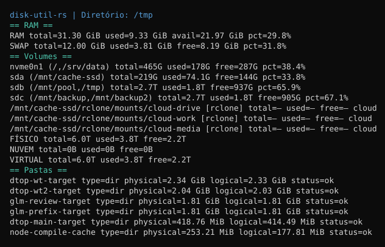

# disk-util-rs

Interactive disk, RAM and system resource monitor — a Rust TUI (ratatui) for exploring folder sizes, physical disk consolidation and multi-host SSH views, in the same style as [docker-top-rs](https://github.com/lgldsilva/docker-top-rs).




## Why

Existing disk usage tools either walk slowly (`du`), fork per directory, or ignore the quirks of real machines: FUSE mounts that hang, ZFS pools counted per dataset, hardlinks double-counted, remote hosts invisible. `disk-util-rs` is a from-scratch Rust rewrite of a Python tool I used for years, built to be fast (one parallel walk), correct (apparent vs allocated sizes, hardlink dedup) and honest (fake FUSE sizes and SSH failures are shown, never hidden).

## Features

- **Native parallel walk** ([jwalk](https://crates.io/crates/jwalk) + rayon): one walk produces both apparent (`st_size`) and allocated (`st_blocks × 512`) sizes. No `du` fork. Hardlink dedup via `DashSet<(dev,ino)>`, cross-device detection via `st_dev`.
- **FUSE mounts are never walked**: inside an rclone mount it measures the local VFS cache (`~/.cache/rclone/vfs/<remote>/...`) instead.
- **RAM via sysinfo**; disks via sysinfo with **statvfs skipped on `fuse.rclone`** (marked as fake size, never hangs on a dead FUSE mount).
- **SSH without russh**: forks `ssh host df -Pk` (argv array, no shell), so `~/.ssh/config` (ProxyJump etc.) keeps working; semaphore + timeout + TTL cache. Hosts are **discovered dynamically** from `~/.ssh/config` (dedup by HostName+Port); connection failures stay visible (panel + `d` popup) instead of disappearing.
- **Physical disk consolidation**: `lsblk -J` maps each partition/LUKS to its parent physical disk and `zpool list` reports real ZFS pool numbers — local volumes are **consolidated per disk** (one line per `sda`, `nvme0n1`, pool…), no double counting of datasets/subvolumes.
- **Collection tick decoupled from render**: collector runs in a tokio task; the TUI only reads snapshots.

## Install

From source (Rust 1.75+):

```bash
cargo install --git https://github.com/lgldsilva/disk-util-rs
```

Prebuilt binaries for Linux (x86_64), macOS (x86_64/aarch64) and Windows are attached to every [release](https://github.com/lgldsilva/disk-util-rs/releases).

## Usage

```bash
disk-util-rs --once --ssh-hosts '' /tmp   # one shot and exit (default without -w)
disk-util-rs -w 10                        # interactive watch (10s)
disk-util-rs --once                       # SSH hosts discovered from ~/.ssh/config
disk-util-rs --only-volumes --once
disk-util-rs --only-folders -w 5
disk-util-rs --show-boot --once           # reveal /boot and /boot/efi
disk-util-rs --ssh-hosts arm-node1,arm-node2 --once
disk-util-rs --cloud-size --once          # cache-logical sizes for "fake" cloud mounts
disk-util-rs --generate-config-example    # writes config.example.toml
```

### Keybindings

| Key | Action |
| --- | --- |
| Up/Down | cursor (anchored by name: no jumping on rescan) |
| Enter / Backspace-Left | enter dir / go to parent |
| `/` | incremental search (cursor jumps to match) |
| `f` | inline filter (Enter confirms, Esc cancels) |
| `o` / `s` | cycle physical→logical→name→type / reverse order |
| `r` | rescan current folder |
| `d` | SSH connection failure details (host, reason, stderr) |
| `b` | show/hide boot partitions |
| `R` | reload config (also via SIGHUP) |
| `h` / `q` | help / quit |

## Configuration

Precedence (last wins): **defaults < file < env < CLI**, via [figment](https://crates.io/crates/figment) + serde `deny_unknown_fields` (unknown field = error).

- File: `~/.config/disk-util/config.toml` (`--config` for another path).
- Env: `DISK_UTIL_*`, nested with `__` (e.g. `DISK_UTIL_TIMEOUTS__SSH_SECS=4`).
- Hot reload: `R` key or `SIGHUP`.
- Versioned schema: `config.example.toml` (generated from defaults; a snapshot test locks it against accidental changes).

Nothing is hardcoded: default watch interval, SSH hosts (auto-discovered from `~/.ssh/config`), rclone paths, fake-size threshold, partition filters, boot mounts, warn/crit thresholds, walk/ssh timeouts, ssh cache TTL and keybindings — all in TOML.

### Consolidation and discovery

- `[partitions] group_by = "disk"` (default): local volumes consolidated by physical disk/ZFS pool via `lsblk -J` + `zpool list -Hp`; one line like `sda (/, /boot)` with real pool numbers. `"device"` restores the per-mountpoint view.
- `[ssh] auto_discover = true` (default): unique targets from `~/.ssh/config` (aliases to the same HostName+Port collapse; `*`/`?` patterns and `Match` blocks ignored; `Include` resolved) merged with `ssh_hosts`.
- `[ssh] ignore_hosts = []`: exclude targets from scanning.
- `[timeouts] disk_discover_secs = 2.0`: `lsblk`/`zpool` timeout (TTL cached; without those commands it degrades to grouping by device).
- SSH connection failures: a down host shows in red in the panel (`Host: x — failed (…)`), `d` opens the detail popup (type, exit code, stderr), `--once` prints `host FAILED: reason`.

## Architecture (`src/`)

| Module | Responsibility |
|---|---|
| `main.rs` | CLI→config, `--once`, TUI loop, SIGHUP, collector task |
| `config.rs` | dynamic TOML (figment), validations, `config.example.toml` |
| `cli.rs` | clap derive, CLI>config effective values |
| `walk.rs` | jwalk+rayon walk, apparent+allocated, dedup, xdev, cancel |
| `scan.rs` | `FolderScanner`: one task/scan, `CancellationToken`, FUSE→cache redirect |
| `system.rs` | RAM/volumes via sysinfo, per-disk/pool consolidation, PHYSICAL/CLOUD/VIRTUAL, rclone cache |
| `mounts.rs` | `/proc/mounts`, `is_remote_fs`, filters, `is_fake_size` |
| `disks.rs` | dynamic identification: `lsblk -J` (parent disk) + `zpool list` (pools), TTL cache |
| `rclone.rs` | own rclone.conf parser, `cache_path`, mount info |
| `ssh.rs` | `ssh df -Pk` fork, semaphore, timeout, TTL cache, `df -P` parser, `SshFailure` |
| `ssh_config.rs` | host discovery: `Host`/`Match`/`Include` parsing, dedup, merge |
| `app.rs` | sort/filter/search/anchor of the browser + key actions |
| `ui.rs` | ratatui render (RAM, consolidated disks, SSH + failure popup, browser, footer) |
| `once.rs` | `--once` report (text, schema-stable) |
| `format.rs` | `format_size`, bars, warn/crit levels |

## Golden output

`docs/golden-python-once.txt` holds a reference `--once` output (sizes/percentages/times masked) from the original Python tool; `tests/golden.rs` locks the schema (panels/sections), not values.

## Security notes

The tool only reads local filesystem metadata and runs `ssh <host> df -Pk` / `lsblk` / `zpool list` for discovery. It never sends data anywhere. Your `~/.ssh/config` is read locally for host discovery; no credentials are read or stored.

## Tests and gates

```bash
cargo fmt --check
cargo clippy --all-targets -- -D warnings
cargo test
```

Unit + proptest (`df -P`, rclone.conf, lsblk JSON, `zpool list`, ssh_config, format/mounts parsers) + insta (default TOML snapshot) + golden schema. TUI tested headless (TestBackend with a key script).

## License

[MIT](LICENSE)
